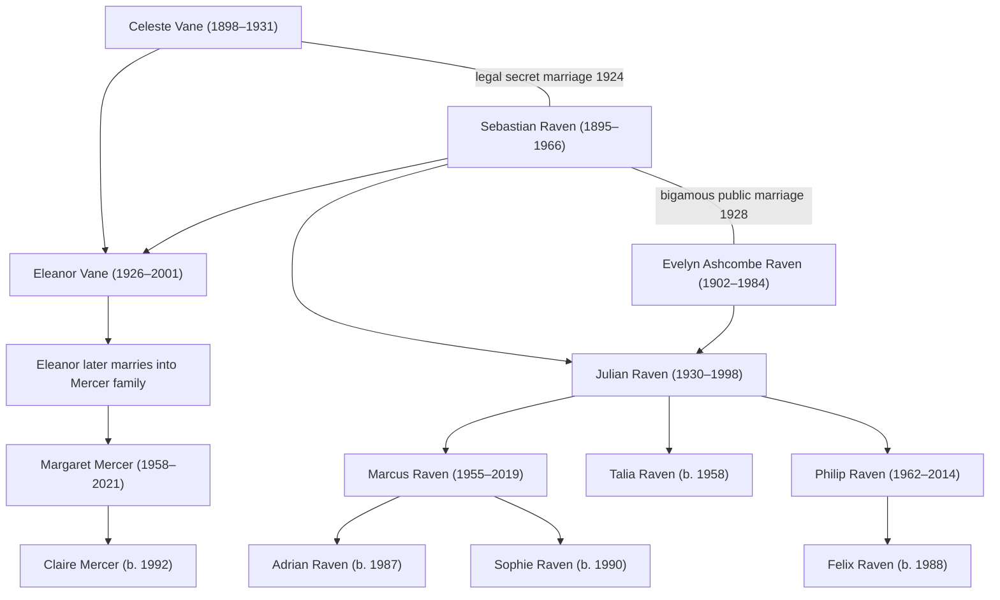

# Raven / Vane / Mercer Family Tree

## Legal note
The plot does **not** depend on illegitimacy. The property problem is a defective title chain because Celeste owned Raven House and the 1932 post-death transfer was forged.
